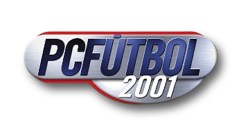

<p align="center"></p>

# pcf2001-recomp

Recompilación estática de **PC Fútbol 2001** (Dinamic Multimedia, 2000): el ejecutable original y sus DLL se traducen
de x86 a C y se compilan a un programa nativo de Windows, y a WebAssembly para jugar en el navegador, sin emulador. Un
runtime propio imita las piezas de Windows y DirectX que el juego usa (ventanas, archivos, Direct3D 7, DirectSound,
DirectShow, OLE…) sobre SDL2.

> **Proyecto no oficial**, de preservación y estudio, sin relación con Dinamic Multimedia ni con los titulares actuales
> de PC Fútbol. «PC Fútbol», «Dinamic» y el logo son marcas y obras de sus respectivos dueños. Este repo **no incluye
> ninguna parte del juego**: para usarlo hace falta una copia original propia (la ISO del CD).

## Estado

Se juega en Windows con ventana y pantalla completa: presentación, menú, pretemporada, hub del manager, partido en
modo resultado y en **visionado 3D**, pausa, cambio de resolución, y **sonido completo** (efectos, relator, ambiente
y música). Pendiente principal: un crash al volver del partido al menú. Detalle y pendientes en orden en
[`docs/estado.md`](docs/estado.md).

## Frontera legal (dura)

- Este repo **no contiene ninguna parte del juego original** ni de las DLL de Microsoft, y **nunca** contiene el C
  generado a partir de ellas (es obra derivada). Todo eso se genera en `generated/`, ignorado por git, desde la copia
  propia del usuario (la ISO del CD).
- Licencia GPL-3.0 (`LICENSE`). La licencia cubre sólo el código de este proyecto. No cubre el juego original, sus
  datos ni el logo, que pertenecen a sus dueños. El código de terceros y su licencia: [`docs/procedencia.md`](docs/procedencia.md).

## Requisitos (Windows)

- Git Bash, Python 3.13 con `pip install -r requirements.txt` (capstone), LLVM/clang (`C:\Program Files\LLVM`).
- SDL2 2.32.10 para Visual C (SDL2-devel-2.32.10-VC) descomprimido en `third_party/sdl2/SDL2-2.32.10` (ignorado).
- 7-Zip (`C:\Program Files\7-Zip`) y WSL Ubuntu con `unshield` (`sudo apt install unshield`) para el instalador.
- La ISO del CD de PC Fútbol 2001 (etiqueta `PCF_2001`, 687 MB).
- Memoria: traducir pide ~1,4 GB y compilar con 1 proceso, poco; compilar desde cero tarda ~40 min.

## Pasos

```bash
bash tools/pcf2001_preparar.sh /ruta/a/PCF_2001.iso          # ISO -> generated/pcf2001/{cd,instalado,input,c_base}
python tools/recomp/build.py --juego config/juegos/pcf2001.json \
       --input generated/pcf2001/input --out generated/pcf2001/build   # traducir (~6 min)
python tools/recomp/compile.py --build generated/pcf2001/build --jobs 1  # compilar (incremental)
bash tools/pcf2001_jugar.sh                                    # jugar con ventana (F11 pantalla completa, F12 captura)
bash tools/pcf2001_correr.sh 60                                # o 60 s sin ventana, con traza (para depurar), log en generated/pcf2001/run/log.txt
bash tools/pcf2001_web.sh                                      # versión web: compila a WebAssembly y sirve en http://127.0.0.1:8097/
```

La versión web necesita Emscripten (emsdk) en `third_party/emsdk` o en la variable `EMSDK`. El CD se lee por rangos
(no se descarga entero) y la instalación va empaquetada; las partidas quedan en el navegador (IndexedDB).

## Layout

| Ruta | Qué |
|---|---|
| `config/juegos/pcf2001.json` | perfil del juego: imágenes que se traducen, dónde se cargan, carpeta, línea de comandos, etiqueta del CD |
| `tools/recomp/` | traductor x86 → C (`build.py`, `analysis.py`, `translate.py`, `translator.py`), compilación nativa (`compile.py`) y a WebAssembly (`compile_wasm.py`), utilidades de investigación |
| `tools/pcf2001_*.sh` | preparar desde la ISO, jugar con ventana, correr sin ventana con traza, versión web |
| `web/index.html`, `tools/servir_web.py`, `tools/make_cd_index.py` | la página de la versión web, el servidor local con rangos y el índice del CD |
| `src/rt/` | runtime: CPU y memoria (`core/`), cargador, y la imitación de Windows y DirectX (`win/`) |
| `vendor/minimp3/` | decodificador MP3 (dominio público, CC0) |
| `docs/` | estado y pendientes, cómo funciona, ficha técnica del juego, hallazgos de RE |
| `generated/` | todo lo que sale del original (ignorado; jamás se commitea) |

## Documentación

Para un agente que sigue el trabajo: empezar por [`AGENTS.md`](AGENTS.md).


- [`docs/estado.md`](docs/estado.md): qué anda, pendientes en orden, cómo se trabaja.
- [`docs/como-funciona.md`](docs/como-funciona.md): el método, el mapa del runtime, las trazas y cómo depurar un crash.
- [`docs/ficha-tecnica.md`](docs/ficha-tecnica.md): el juego por dentro (CD, instalador, DLL, motores de dibujo, mapa de memoria) y los problemas ya resueltos con su causa.
- [`docs/re/sonido-y-musica.md`](docs/re/sonido-y-musica.md): cómo suenan efectos y música (DirectSound, mmio, DirectShow, `SFX.DAT`).
- [`docs/optimizaciones.md`](docs/optimizaciones.md): optimizaciones recomendadas a perseguir (audio sin cortes, cargas, velocidad de la web).
- [`docs/procedencia.md`](docs/procedencia.md): código de terceros y licencias.
